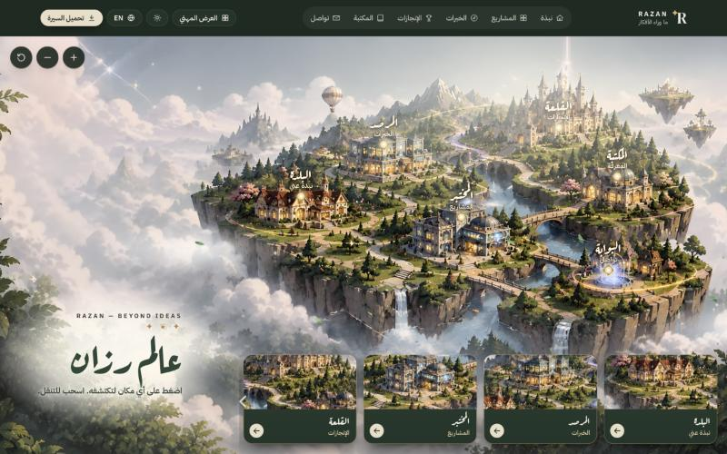

# RAZAN — Beyond Ideas · رزان — ما وراء الأفكار

**Turning ideas into impact.** · **أحوّل الأفكار إلى أثر.**

[**Visit the site · زيارة الموقع**](https://rznpro.github.io/razan-portfolio/) &nbsp;·&nbsp; [**Explore the world · استكشف العالم**](https://rznpro.github.io/razan-portfolio/world.html) &nbsp;·&nbsp; [**CV · السيرة**](https://rznpro.github.io/razan-portfolio/cv.html)

---

## عن الموقع

هذا ملفي الشخصي: **مديرة منتجات وابتكار** — أولّد الأفكار، وأصممها، وأقودها لين تصير منتجًا أو مشروعًا له أثر. ومعها: محللة أعمال، ومصممة منتجات رقمية، ومطوّرة حلول ذكاء اصطناعي. الموقع واجهتان مترابطتان لنفس المحتوى، كل واحدة لقارئ مختلف.

## المميزات

- **خريطة تفاعلية** — جزيرة طائرة مرسومة، كل مبنى فيها قسم، وتقترب الكاميرا منه بضغطة.
- **عرض مهني سريع** — نفس المحتوى بترتيب واضح لمن يبغى المعلومة مباشرة.
- **دراسات حالة للمشاريع** — التحدي، والدور، والمنهج، والحل، و**نتائج بأرقام حقيقية**، مع الروابط والمواد (مواقع، تطبيقات، عروض وملفات PDF).
- **لقطات من كل مشروع** — شاشات حقيقية من المواقع والتطبيقات، تكبر بضغطة.
- **سيرة ذاتية تلقائية** — تُبنى من نفس المحتوى، و**تتحمّل PDF بضغطة وحدة** (عربي أو إنجليزي).
- **كلمات ممن عرفوني** —
- **عربي وإنجليزي** — 
- **وضع فاتح وغامق** — والخريطة تبقى نهارًا في الوضعين.
- **محرر محتوى محلي** — أعدّل النصوص والصور والأيقونات بدون ما ألمس الكود، و:
  - **ينشر مباشرة على الموقع** بضغطة.
  - **يترجم تلقائيًا** بين العربي والإنجليزي ليبقى النص متطابقًا.
  - **يقترح تصحيحات** تحت النصوص الطويلة.
  - **يضبط الصورة في البطاقة**: تعبئة أو صورة كاملة، وحجم، والجزء الظاهر.
- **جاهز للبحث والمشاركة** — معاينة للرابط بصورة ووصف، وخريطة موقع لقوقل، وصفحة ٤٠٤ بتصميم الموقع.

## لقطات الشاشة

### ١. العالم التفاعلي — خريطة حيّة

| المكان | القسم |
|---|---|
| البلدة | نبذة عني |
| المرصد | الخبرات |
| المختبر | المشاريع |
| القلعة | الإنجازات |
| المكتبة | المعرفة والمهارات |
| البوابة | التواصل |

### ٢. العرض المهني — الموقع

النبذة، والمشاريع، والخبرات، والإنجازات، والمكتبة، والتواصل — بزجاج شفاف وحركة خفيفة.

## التقنيات

- **HTML وCSS وJavaScript** خالصة — بدون أي خطوة بناء.
- **رسومات الخريطة** مقسّمة إلى طبقات ومكبّرة بدقة عالية، عشان تبقى حادّة عند التقريب.
- **كل النصوص** في `assets/js/content.js`، ومحرر محلي (`admin.html`) يعدّلها.
- **تشغيل المحرر:** ضغطتين على `تشغيل المحرر.command` — يفتح المحرر (`tools/studio.py`) وينشر ويترجم.
- **ملفات السيرة PDF:** `tools/cv_pdf.py` يحوّل صفحة السيرة إلى PDF بمحرك WebKit في الماك.
- **التشغيل محليًا:** `python3 -m http.server 5173` ← http://localhost:5173
- **النشر** تلقائي على GitHub Pages مع كل دفع (push) إلى فرع `main`.

## ليش اخترت هذا التصميم؟

ما كنت أبغى أختار بين إني أكون **مبدعة** أو **مهنية**، لأنهم مو نقيضين. فبنيت موقعًا يبدو كعالم خيالي من لعبة، لكنه يتصرّف كملف مهني تنفيذي:

- **العالم تفاعلي، والوصول للمعلومات مباشر.** مسؤول التوظيف ما يحتاج يلعب عشان يعرف مؤهلاتي: «العرض المهني» دائمًا على بعد ضغطة.
- **الرسومات خيالية، والنصوص مهنية.** والمشاريع تظهر كأماكن في العالم، لكن تفاصيلها دراسات حالة احترافية.
- **الخريطة تمثّل عقلي المهني:** كل منطقة فيها طريقة من طرق تحويل الفكرة إلى أثر.

الرسالة اللي أبغاها توصل: *« أستخدم الإبداع لصناعة تجارب وحلول»*

---

## About (English)

My portfolio as two connected interfaces over the same content.

## Features

- **Explorer World** — a painted floating island where each building is a section (Town → About, Observatory → Experience, Lab → Projects, Castle → Achievements, Library → Knowledge, Gateway → Contact). Click a building to fly to it.
- **Professional View** — the same content, fast and clear.
- **Case studies** — challenge, role, approach, solution, **outcomes with real figures**, links and materials.
- **Screens from every project** — real screenshots of the sites and apps, enlarged with a click.
- **Auto-generated CV** built from the same content — **one-click PDF download** (Arabic or English).
- **Words from people I’ve worked with** — 
- **Arabic / English** and **light / dark**.
- **Local content editor** for text, images and icons — publishes straight to the live site, auto-translates Arabic ↔ English, suggests fixes under long texts, and frames each picture (fill / whole, zoom, focus point).
- **Search & share ready** — link previews, a sitemap and a custom 404 page.

## Technologies

- Plain HTML, CSS and JavaScript — no build step.
- Painted map art layered and upscaled for sharp zoom.
- All text lives in `assets/js/content.js`; a local editor (`admin.html`) edits it.
- Edit: double-click `تشغيل المحرر.command` — opens the editor studio (`tools/studio.py`) that publishes and translates.
- CV PDFs: `tools/cv_pdf.py` renders the CV page with macOS WebKit.
- Run locally: `python3 -m http.server 5173` → http://localhost:5173
- Deploys to GitHub Pages on every push to `main`.

## Why this design

Creative and professional aren't opposites. The site *looks* like a world but *behaves* like an executive portfolio — a recruiter never has to play to find my qualifications. No pictures of people, so the impression is of the work, not of me.

© Razan Al-Awadh
