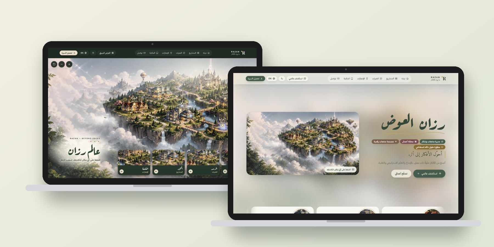
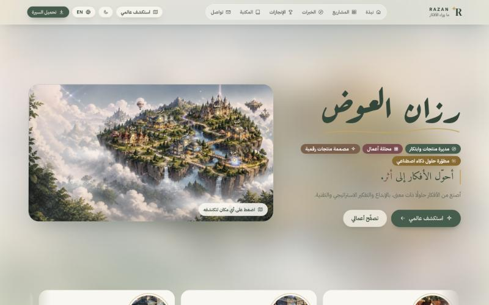

# RAZAN — Beyond Ideas · رزان — ما وراء الأفكار

**Turning ideas into impact.** · **أحوّل الأفكار إلى أثر.**

[**Visit the site · زيارة الموقع**](https://rznpro.github.io/razan-portfolio/) &nbsp;·&nbsp; [**Explore the world · استكشف العالم**](https://rznpro.github.io/razan-portfolio/world.html) &nbsp;·&nbsp; [**CV · السيرة**](https://rznpro.github.io/razan-portfolio/cv.html)

---

## عن الموقع

هذا ملفي الشخصي: مديرة مشاريع ومحللة أعمال ومصممة منتجات رقمية ومطوّرة حلول ذكاء اصطناعي. الموقع واجهتان مترابطتان لنفس المحتوى، كل واحدة لقارئ مختلف.

### ١. العالم التفاعلي — خريطة حيّة

جزيرة طائرة مرسومة، كل مبنى فيها قسم من مسيرتي:

| المكان | القسم |
|---|---|
| البلدة | نبذة عني |
| المرصد | الخبرات |
| المختبر | المشاريع |
| القلعة | الإنجازات |
| المكتبة | المعرفة والمهارات |
| البوابة | التواصل |

تضغط على أي مبنى فتقترب الكاميرا منه وتنفتح لوحته.

### ٢. العرض المهني — الموقع

نفس المحتوى بترتيب واضح وسريع: النبذة، والمشاريع كدراسات حالة (التحدي، الدور، المنهج، الحل، النتيجة، الروابط)، والخبرات، والإنجازات، والمكتبة، والتواصل، وسيرة ذاتية تُبنى تلقائيًا من المحتوى. بالعربي والإنجليزي، فاتح وغامق، بزجاج شفاف وحركة خفيفة.

## ليش اخترت هذا التصميم؟

ما كنت أبغى أختار بين إني أكون **مبدعة** أو **مهنية**، لأنهم مو نقيضين. فبنيت موقعًا يبدو كعالم خيالي من لعبة، لكنه يتصرّف كملف مهني تنفيذي:

- **العالم تفاعلي، والوصول للمعلومات مباشر.** مسؤول التوظيف ما يحتاج يلعب عشان يعرف مؤهلاتي: «العرض المهني» دائمًا على بعد ضغطة.
- **الرسومات خيالية، والنصوص مهنية.** والمشاريع تظهر كأماكن في العالم، لكن تفاصيلها دراسات حالة احترافية.
- **الخريطة تمثّل عقلي المهني:** كل منطقة فيها طريقة من طرق تحويل الفكرة إلى أثر.

الرسالة اللي أبغاها توصل: *« أستخدم الإبداع لصناعة تجارب وحلول»*

---

## About (English)

My portfolio as two connected interfaces over the same content:

1. **Explorer World** — a painted floating island where each building is a section (Town → About, Observatory → Experience, Lab → Projects, Castle → Achievements, Library → Knowledge, Gateway → Contact). Click a building to fly to it. Layered parallax art, a flowing river, leaping fish, drifting leaves.
2. **Professional View** — the same content, fast and clear: case studies (challenge, role, approach, solution, outcome, links), experience, awards, skills and an auto-generated CV. Arabic/English, light/dark.

**Why:** creative and professional aren't opposites. The site *looks* like a world but *behaves* like an executive portfolio — a recruiter never has to play to find my qualifications. No pictures of people, so the impression is of the work, not of me.

## Built with

Plain HTML, CSS and JavaScript — no build step. Painted map art layered and upscaled for sharp zoom. All text lives in `assets/js/content.js`; a local editor (`admin.html`) edits it.

Run locally: `python3 -m http.server 5173` → http://localhost:5173 · Deploys to GitHub Pages on every push to `main`.

© Razan Al-Awadh
